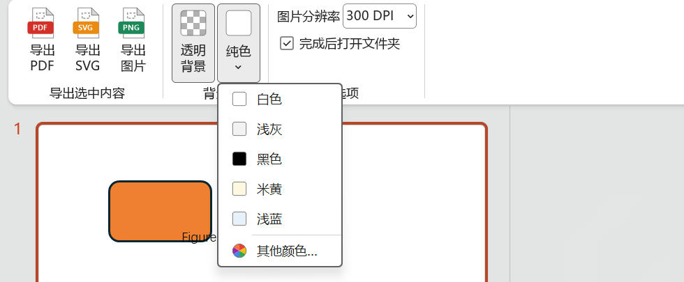

# Export Selection for PowerPoint

**English** | [简体中文](README.zh-CN.md)

A small PowerPoint add-in for people who draw their figures in PowerPoint.
Select some objects on a slide, click one button, and get **just those objects** as a
**PDF**, **SVG**, **PNG** or **JPG** — cropped to the smallest rectangle around them,
with a transparent or solid-colour background.



*(The interface is Chinese on a Chinese edition of Office and English on every other edition.)*

## Why

Getting one figure out of a slide for a paper, a thesis or a LaTeX document usually means
exporting the whole slide and cropping it by hand, or resizing the slide to fit the drawing.
This add-in does it in one click:

- **Tight crop.** The output is exactly the bounding box of what you selected — the same box
  PowerPoint uses for *Save as Picture*, so outlines, arrowheads and shadows are not cut in half.
- **Only what you selected.** Other objects, the slide background and the master artwork are left out.
- **Vector PDF and SVG.** Text stays text (fonts are embedded in the PDF); shapes stay shapes.
- **PNG / JPG at 96 – 600 DPI**, with the DPI stored in the file so it has the right physical size.
- **Transparent or coloured background**, for all formats (JPG has no transparency; it uses white instead).
- **Leaves your document alone.** No changes to the presentation, the undo history or the clipboard.

## Install

Requirements: Windows, desktop PowerPoint from Microsoft 365 or Office 2019 / 2021 / 2024
(32- or 64-bit). No administrator rights needed.

1. Download **[PptSelectionExport-Setup.exe](https://github.com/Avopears/ppt-selection-export/raw/main/dist/PptSelectionExport-Setup.exe)**.
2. Close PowerPoint and run the installer. You can keep the suggested location or pick your own folder.
3. Start PowerPoint. The **Export Selection** tab is right after **View**.


The installer is not code-signed, so Windows SmartScreen may show *"Windows protected your PC"*
the first time. Choose **More info → Run anyway**, or build the installer yourself from the
source (see below) if you prefer.

To remove it: Windows **Settings → Apps → Installed apps → Export Selection for PowerPoint → Uninstall**,
or run the installer again and choose **Uninstall**.

<details>
<summary>Other ways to install</summary>

- **Without the exe:** download this repository as a ZIP, unpack it, close PowerPoint and
  double-click `install.bat` (`uninstall.bat` removes it).
- **Silently:** `PptSelectionExport-Setup.exe /S` installs (add `/DIR="D:\Tools"` to choose the folder),
  `PptSelectionExport-Setup.exe /uninstall /S` removes.

Everything is per user: the add-in is copied to `%LOCALAPPDATA%\PptSelectionExport` (or to a
`PptSelectionExport` folder inside the location you choose) and registered under `HKEY_CURRENT_USER`.
Uninstalling removes only the add-in's own files, never anything else in that location.
</details>

## Use

1. Select the objects to export on a slide (Shift/Ctrl-click, or drag a selection box).
   You can also select individual objects inside a group.
2. In **Background** choose **Transparent** or **Color** (the arrow under *Color* offers presets and *More colors…*).
3. Click **Export PDF**, **Export SVG** or **Export Image** and choose where to save.
   *Export Image* lets you pick PNG or JPG in the save dialog; **Image resolution** sets its DPI.

## Good to know

- PDF export needs objects selected on a slide in the normal view. Objects on a master, a layout
  or a notes page can be exported as SVG or as an image.
- Shadows, glows and similar effects are bitmaps inside the PDF. That is how PowerPoint writes them.
- SVG keeps text as text and refers to fonts by name, so a font that is missing on another
  computer is substituted there. Use PDF when the exact look matters.
- For PDF export the add-in first saves a temporary copy of the presentation, so very large
  files (hundreds of MB) take a moment.
- A selection larger than 56 inches (PowerPoint's maximum slide size) is clipped in the PDF.

Tested on Microsoft 365 (64-bit, Chinese interface, build 16.0.20625) on Windows 11.
The English interface and other Office versions are expected to work but have not been
tested yet — [bug reports](https://github.com/Avopears/ppt-selection-export/issues) are welcome.

## Build from source

No Visual Studio needed — the C# compiler that ships with Windows (.NET Framework 4) is enough,
plus an installed copy of Office:

```powershell
powershell -ExecutionPolicy Bypass -File .\build.ps1
```

This writes `dist\PptSelectionExport.dll` (the add-in) and `dist\PptSelectionExport-Setup.exe`
(the installer, with the DLL embedded).

```powershell
powershell -ExecutionPolicy Bypass -File .\tests\run.ps1
```

runs the export tests against the PowerPoint on your machine: it builds a throw-away
presentation and exports many kinds of selections in every format.

| File | What it does |
| --- | --- |
| `src/Connect.cs` | Add-in entry point; ribbon callbacks |
| `src/Ribbon.xml` | The ribbon tab |
| `src/Exporter.cs` | The SVG, PNG/JPG and PDF export pipelines |
| `src/PdfCropper.cs` | Crops PowerPoint's full-slide PDF to the selection (PDF incremental update) |
| `src/SvgTools.cs` | Reads the selection bounds; adds the SVG background |
| `src/Strings.cs` | All interface text, Chinese and English |
| `src/Icons.cs`, `src/Settings.cs` | Ribbon icons drawn in code; remembered settings |
| `installer/Setup.cs` | The exe installer / uninstaller |
| `tests/TestHarness.cs` | Export tests that drive PowerPoint directly |

### How it works

- **SVG and PNG/JPG** come from PowerPoint's own `ShapeRange.Export`, which already crops to the
  visual bounds and keeps transparency. The add-in adds the background, the `viewBox`, the
  requested resolution and the DPI tag.
- **PDF**: PowerPoint can only export whole slides. The add-in saves a temporary copy of the
  presentation, hides everything that is not selected, removes the slide background, exports
  that one slide, and then appends a PDF incremental update that sets the page box to the
  selection. Nothing is rasterised and the original bytes are not rewritten.

## License

[MIT](LICENSE)
