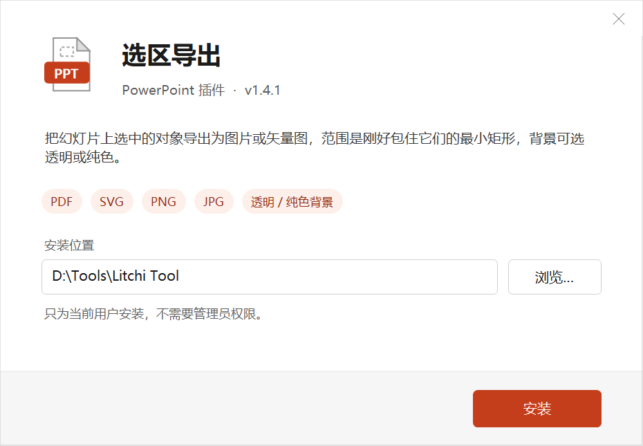
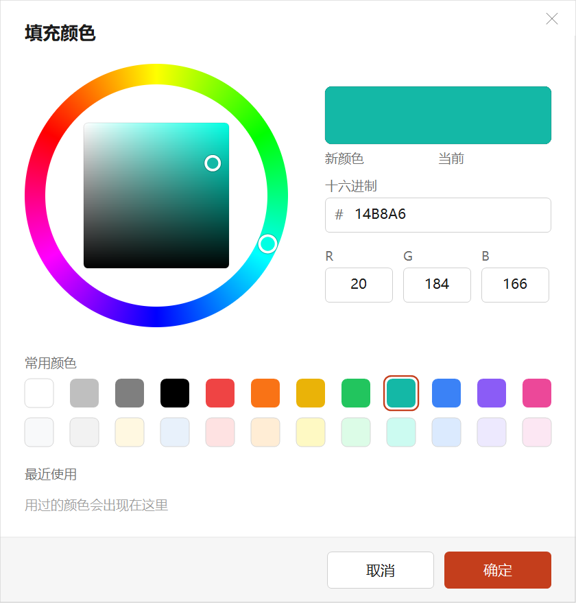
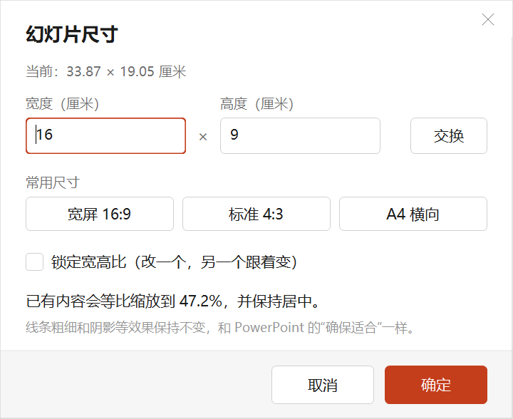
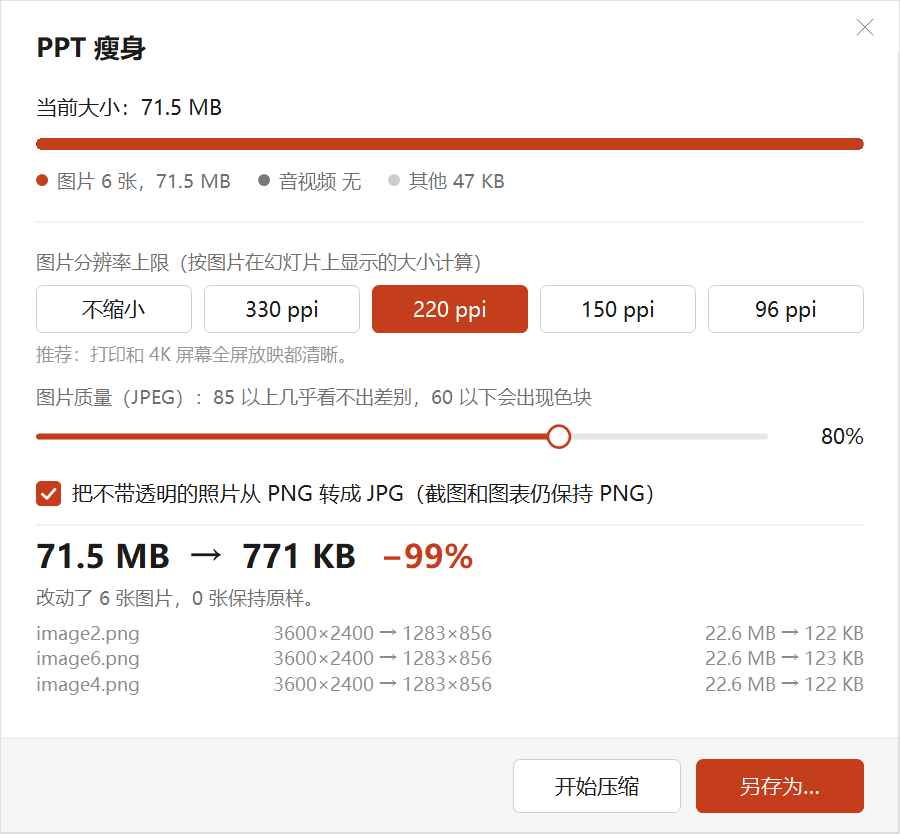

# Litchi PPT Tool

**English** | [简体中文](README.zh-CN.md)

*Export Selection for PowerPoint* — a small add-in for people who draw their figures in PowerPoint.
Select some objects on a slide, click one button, and get **just those objects** as a
**PDF**, **SVG**, **PNG** or **JPG** — cropped to the smallest rectangle around them,
with a transparent or solid-colour background.
It also has one-click **align and distribute** buttons (which can align to a chosen object and
leave connectors glued to their shapes), **rotate / flip**, **stacking order** and **boolean**
(merge shapes) buttons,
a **Style** group for the fill colour, outline colour, weight, dashes and cap type of the selected shapes,
**Slide Size** in centimetres (what is on the slides is scaled to fit),
and **Slim Down**, which compresses the pictures into a smaller copy of the presentation.


*(The interface is Chinese on a Chinese edition of Office and English on every other edition.)*

## Why

Getting one figure out of a slide for a paper, a thesis or a LaTeX document usually means
exporting the whole slide and cropping it by hand, or resizing the slide to fit the drawing.
This add-in does it in one click:

- **Tight crop.** The output is exactly the bounding box of what you selected — the same box
  PowerPoint uses for *Save as Picture*, so outlines, arrowheads and shadows are not cut in half.
- **Only what you selected.** Other objects, the slide background and the master artwork are left out.
- **Vector PDF and SVG.** Text stays text (fonts are embedded in the PDF); shapes stay shapes.
- **PNG / JPG at 96 – 600 DPI**, with the DPI stored in the file so it has the right physical size.
- **Transparent or coloured background**, for all formats (JPG has no transparency; it uses white instead).
- **Leaves your document alone.** No changes to the presentation, the undo history or the clipboard.

## Install

Requirements: Windows, desktop PowerPoint from Microsoft 365 or Office 2019 / 2021 / 2024
(32- or 64-bit). No administrator rights needed.

1. Open the **[latest release](https://github.com/Avopears/litchi-ppt-tool/releases/latest)** and download
   the installer under *Assets*. Its name carries the version, for example `Litchi-Setup-1.7.2.exe`.
2. Close PowerPoint and run the installer. You can keep the suggested location or pick your own folder.
3. Start PowerPoint. The add-in's tab is called **Litchi** and sits right after **View**.



The installer is not code-signed, so Windows SmartScreen may show *"Windows protected your PC"*
the first time. Choose **More info → Run anyway**, or build the installer yourself from the
source (see below) if you prefer.

**Upgrading:** just run the new installer and click **Upgrade**. It first removes the installed
version completely (its files and its registration) and then installs the new one; your saved
settings are kept.

To remove it: Windows **Settings → Apps → Installed apps → Export Selection for PowerPoint → Uninstall**,
or run the installer again and choose **Uninstall**.

<details>
<summary>Other ways to install</summary>

- **Without the exe:** download this repository as a ZIP, unpack it, close PowerPoint and
  double-click `install.bat` (`uninstall.bat` removes it).
- **Silently:** `Litchi-Setup-<version>.exe /S` installs (add `/DIR="D:\Tools\Litchi"` to choose the folder),
  `Litchi-Setup-<version>.exe /uninstall /S` removes.

Everything is per user: the add-in is copied to `%LOCALAPPDATA%\Litchi Tool` or to the
folder you choose (if that folder already contains other things, a `Litchi Tool` folder is
created inside it) and registered under `HKEY_CURRENT_USER`.
Uninstalling removes only the add-in's own files, never anything else in that location.
</details>

## Use

1. Select the objects to export on a slide (Shift/Ctrl-click, or drag a selection box).
   You can also select individual objects inside a group.
2. In **Background** choose **Transparent** or **Color** (the arrow under *Color* offers presets and *More colors…*).
   *More colors…* opens a colour picker: drag around the hue ring and in the square inside it
   (white to the pure colour from left to right, darker towards the bottom), or type a hex
   or RGB value; below are common colours and the ones you used recently (double-click one to take it).
3. Click **Export PDF**, **Export SVG** or **Export Image** and choose where to save.
   *Export Image* lets you pick PNG or JPG in the save dialog; **Image resolution** sets its DPI.



### Align

The nine buttons of the **Align** group (hover over one to see its name and what it does):

| | Buttons |
| --- | --- |
| Row 1 | Align Left · Align Center · Align Right |
| Row 2 | Align Top · Align Middle · Align Bottom |
| Row 3 | Distribute Horizontally · Distribute Vertically · Align to Object (on/off) |

- **Align**: with several objects selected, they line up within their overall bounds, like
  PowerPoint's own commands; a single object is aligned to the slide.
- **Distribute**: the two outermost objects stay put and the ones between are spaced evenly
  (select at least 3).
- **Align to Object**: when on, the **first object you select** is the reference and does not move.
  Click it first, Shift- or Ctrl-click the others, then click an align button. Distributing then
  spreads the other objects evenly inside the reference object (with the same gap at both ends),
  which is handy for placing items evenly in a box. The setting is remembered.
- **Connectors stay glued**: a selected connector that is glued to shapes is not aligned on its
  own; it follows the shapes it is glued to. (PowerPoint's own commands tear such connectors off.)
- Rotated objects are aligned and distributed by the space they actually take up.
- Each click is a single undo step: one Ctrl+Z takes it back.

### Rotate

**Rotate Left 90°**, **Rotate Right 90°**, **Flip Horizontal**, **Flip Vertical**: each selected
object turns or mirrors about its own centre and stays where it is.

### Order

For objects that overlap: **Bring to Front**, **Bring Forward** (top row) and **Send to Back**,
**Send Backward** (bottom row) — the same four commands as PowerPoint's *Arrange* menu, one click away.

- Several selected objects keep their order among themselves and move together.
- An object selected inside a group is reordered inside that group.
- Each click is a single undo step.

### Merge

**Union**, **Combine** (overlaps cut out), **Subtract** and **Fragment**: PowerPoint's *Merge Shapes*.

- The shape you click first is the primary one: the result keeps its fill and outline, and
  *Subtract* cuts the other shapes out of it.
- Select at least 2 shapes. Groups have to be ungrouped first.
- The result is selected afterwards; one Ctrl+Z takes it back.

### Style

Five drop-down lists change how the selected shapes look, without leaving the Litchi tab:

- **Fill**: click a swatch to fill the shapes with it. *No Fill* and *More Colors…* are below the grid.
- **Outline**: the outline colour; for lines and connectors that is the colour of the line itself.
  *No Outline* and *More Colors…* are below the grid.
- **Weight**: the outline weight in points, from 0.25 to 6; *More Weights…* takes any value from 0.05 to 100.
- **Dashes**: solid, round dot, square dot, dash, dash dot, long dash, long dash dot, long dash dot dot.
- **Cap**: the shape of a line's two ends (and of the ends of every dash) — square, round or flat,
  the *Cap type* setting under *Format Shape → Line*. Flat stops exactly at the end point, square
  reaches half the line weight past it, round ends in a half circle.

The colour grids hold the same palette as the colour picker, followed by the colours you used
recently; *More Colors…* opens that picker, where you can also type a hex or RGB value.

- Every shape inside a selected group is changed; you can also select single shapes inside a group.
- Lines have no fill and are skipped by *Fill*. Tables, charts and similar objects are skipped.
- Choosing a weight or a dash style gives a shape without an outline one, as PowerPoint does.
- Each choice is a single undo step.
- **Cap** works differently from the others: PowerPoint gives add-ins no way to change a cap type,
  so the add-in saves a temporary copy of the presentation, makes the change there and copies the
  format back. That is why it only works for objects on a slide (not on a master, a layout or a
  notes page) and takes a moment for very large files. Nothing else about the shapes changes,
  their text included.

### Slide Size

**Slide Size** in the **Slide** group sets the width and height of the slides in centimetres.
What is already on them is scaled to fit and stays centred, as with PowerPoint's *Ensure Fit*:
by the **smaller** of the two ratios (new width / old width, new height / old height), so that
nothing that was on the slide ends up off it.



- Type a width and a height in centimetres, or pick a common size (Widescreen 16:9,
  Standard 4:3, A4 landscape). *Swap* exchanges the two; with *Lock the proportions* ticked,
  changing one changes the other. The window tells you what percentage the content will be scaled to.
- Scaled together: position, size, font sizes, text margins, paragraph spacing and indents.
  Tables, groups and connectors come along.
- **Line weights and effects such as shadows and glows keep their size**, as in PowerPoint.
- Masters and layouts are stretched with the slide. A placeholder that is where its layout puts
  it follows the layout; one that was moved by hand is scaled like any other shape.
- When the slide grows in both directions, the content grows by the smaller ratio as well.
- Each change is a single undo step.
- PowerPoint stores slide sizes in eighths of a point, so 16 cm is really 15.9985 cm (and is
  still shown as 16).

### Slim Down

**Slim Down** in the **File** group makes the pictures of the presentation smaller and saves the
result as a new file. **The original is not changed.**



1. The top of the window shows how large the file is and how much of it is pictures, video and
   audio, and everything else.
2. Choose a **resolution limit** and a **picture quality**:
   - The resolution is for the size a picture has on its slide: 220 ppi is sharp in print and
     full-screen on a 4K display (the default), 150 ppi is enough for projectors and ordinary
     screens, 96 ppi is the smallest and good for e-mail. *Keep* leaves every pixel and only
     compresses again.
   - The quality is the JPEG quality, 80 % by default: above 85 the difference is hard to see,
     below 60 blocks appear.
3. Click **Compress** to see the size before and after. Change the settings and compress again
   if you like, then click **Save As…**. The dialog starts in the folder of the original file
   and suggests its name with `_compressed` added.

What happens to each picture:

- It is resampled for the size it is **actually shown at**. A picture used in several places is
  sized for the largest; a cropped picture keeps its hidden part in the same proportion, so the
  crop can still be changed later; a picture that has too few pixels already is never enlarged.
- A photo without transparency that is stored as PNG becomes a JPG (often ten times smaller);
  screenshots and charts, which gain little from that, stay PNG, and so does everything with
  transparency. Untick the option to keep all PNGs.
- A picture is only replaced when that makes it smaller. Vector images (EMF, SVG), animated
  GIFs, audio and video are left as they are; the window only tells you how much they take up.
- The compression is lossy and cannot be undone, which is why the result is always a new file:
  it cannot be saved over the presentation that is open.

## Good to know

- In Slim Down, a PNG with transparency can only get smaller by losing pixels: the Windows
  imaging component the add-in uses writes PNG without loss only.

- PDF export needs objects selected on a slide in the normal view. Objects on a master, a layout
  or a notes page can be exported as SVG or as an image.
- Shadows, glows and similar effects are bitmaps inside the PDF. That is how PowerPoint writes them.
- SVG keeps text as text and refers to fonts by name, so a font that is missing on another
  computer is substituted there. Use PDF when the exact look matters.
- For PDF export the add-in first saves a temporary copy of the presentation, so very large
  files (hundreds of MB) take a moment.
- A selection larger than 56 inches (PowerPoint's maximum slide size) is clipped in the PDF.

Tested on Microsoft 365 (64-bit, Chinese interface, build 16.0.20625) on Windows 11.
The English interface and other Office versions are expected to work but have not been
tested yet — [bug reports](https://github.com/Avopears/litchi-ppt-tool/issues) are welcome.

## Build from source

No Visual Studio needed — the C# compiler that ships with Windows (.NET Framework 4) is enough,
plus an installed copy of Office:

```powershell
powershell -ExecutionPolicy Bypass -File .\build.ps1
```

This writes `dist\PptSelectionExport.dll` (the add-in) and `dist\Litchi-Setup-<version>.exe`
(the installer, with the DLL embedded).

```powershell
powershell -ExecutionPolicy Bypass -File .\tests\run.ps1
```

runs the tests against the PowerPoint on your machine: it builds throw-away presentations,
exports many kinds of selections in every format, and aligns and distributes many kinds of
objects, comparing the results with PowerPoint's own commands, and finally tests rotate, flip,
the stacking order, the boolean operations, the colour picker's colour maths, the style commands,
the cap types, the slide size (after each of several new sizes, the position, size and font
sizes of every object are checked) and Slim Down (it slims a presentation full of oversized pictures, checks the pixels
of every picture and compares each slide before and after).
Add `align` to skip the export tests.

| File | What it does |
| --- | --- |
| `src/Connect.cs` | Add-in entry point; ribbon callbacks |
| `src/Ribbon.xml` | The ribbon tab |
| `src/Exporter.cs` | The SVG, PNG/JPG and PDF export pipelines |
| `src/PdfCropper.cs` | Crops PowerPoint's full-slide PDF to the selection (PDF incremental update) |
| `src/SvgTools.cs` | Reads the selection bounds; adds the SVG background |
| `src/Aligner.cs` | Align and distribute |
| `src/ShapeTools.cs` | Rotate, flip, stacking order and the boolean operations |
| `src/StyleTools.cs` | Fill colour, outline colour, weight and dashes |
| `src/LineCaps.cs` | Cap type (set through a temporary copy of the presentation) |
| `src/SlideResizer.cs`, `src/SlideSizeDialog.cs` | Slide Size: changes the size and scales the content by one factor; its window |
| `src/Slimmer.cs`, `src/SlimDialog.cs` | Slim Down: measures how large each picture is shown, resamples and re-encodes it, rewrites the package; its window |
| `src/ColorPicker.cs`, `src/WeightDialog.cs` | The colour picker; the "More Weights…" window |
| `src/Strings.cs` | All interface text, Chinese and English |
| `src/Icons.cs`, `src/Settings.cs` | Ribbon icons drawn in code; remembered settings |
| `installer/Setup.cs` | The exe installer / uninstaller |
| `tests/TestHarness.cs`, `tests/AlignTests.cs`, `tests/ShapeToolsTests.cs`, `tests/StyleTests.cs`, `tests/CapTests.cs`, `tests/ResizeTests.cs`, `tests/SlimTests.cs` | Tests that drive PowerPoint directly |

### How it works

- **SVG and PNG/JPG** come from PowerPoint's own `ShapeRange.Export`, which already crops to the
  visual bounds and keeps transparency. The add-in adds the background, the `viewBox`, the
  requested resolution and the DPI tag.
- **PDF**: PowerPoint can only export whole slides. The add-in saves a temporary copy of the
  presentation, hides everything that is not selected, removes the slide background, exports
  that one slide, and then appends a PDF incremental update that sets the page box to the
  selection. Nothing is rasterised and the original bytes are not rewritten.
- **Cap type**: PowerPoint's object model has no property for it; it only exists in the file, as
  `<a:ln cap="sq|rnd|flat">`. The add-in saves a temporary copy, writes the cap into the copy's
  slide XML, opens the copy without a window and carries the format of the same shape back with
  `PickUp` / `Apply` (the format painter). The shape in the copy has its text removed first, since
  `Apply` would otherwise give all of the shape's text the format of its first run.
- **Slide Size**: PowerPoint's object model can only set the width and then the height, and at
  each step it scales the content on its own: by that step's ratio when the slide shrinks, not
  at all when it grows. A slide made smaller in both directions gets its content shrunk twice;
  one made larger keeps it small. The add-in remembers where every object is and the font
  sizes, margins and spacing of every piece of text, lets PowerPoint resize (which adapts the
  masters and layouts), and then sets every object and every text size to what one common
  factor gives. Text that takes its format from the master is corrected on the master only,
  not overridden on the slide.
- **Slim Down**: a .pptx is a zip package, and nearly all of its size is the pictures under
  `ppt/media`. The add-in saves a temporary copy, reads the XML and the relationships of every
  slide, layout and master to find where each picture file is used and how large it is shown
  (group scaling, cropping, picture fills and backgrounds included), resamples it with GDI+ to
  "size shown × ppi", encodes it again, and writes the whole package anew in its original order.
  A picture whose format changes (PNG to JPG) gets a new name; the relationships that point to
  it and `[Content_Types].xml` are brought in line. Everything else is copied as it is.

## License

[MIT](LICENSE)
