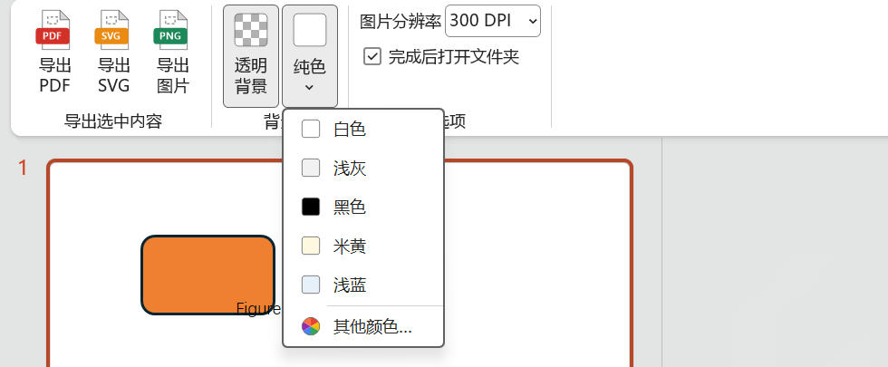
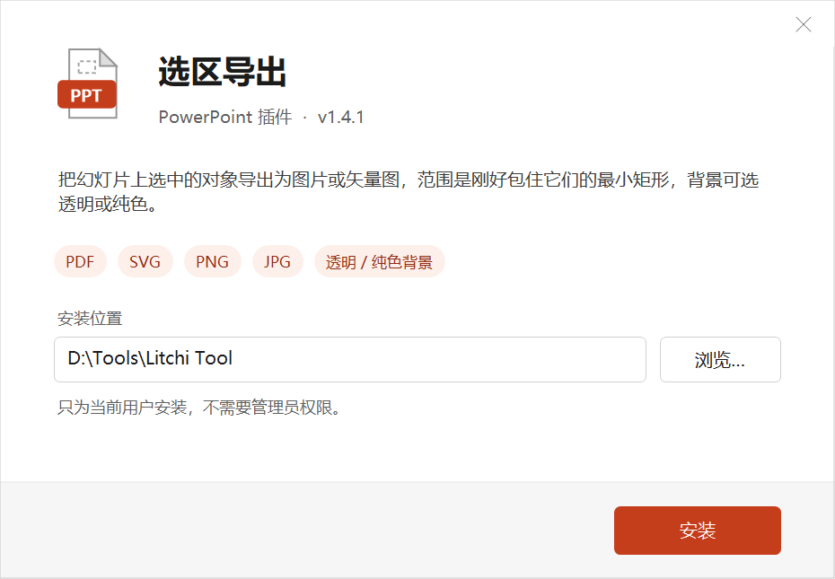
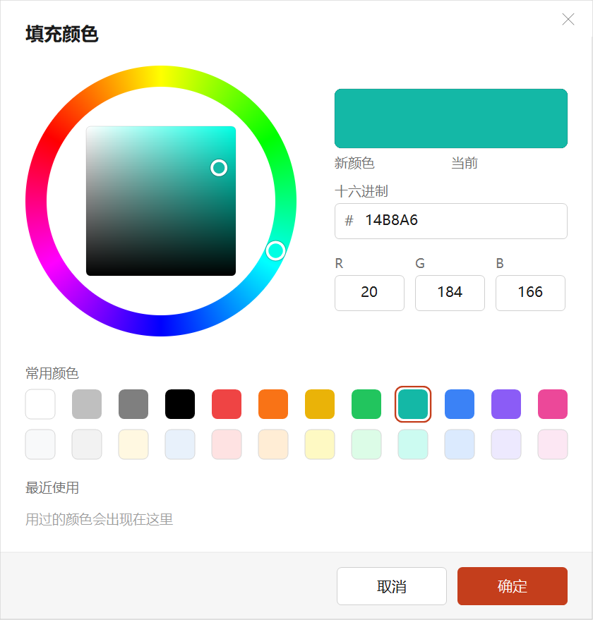
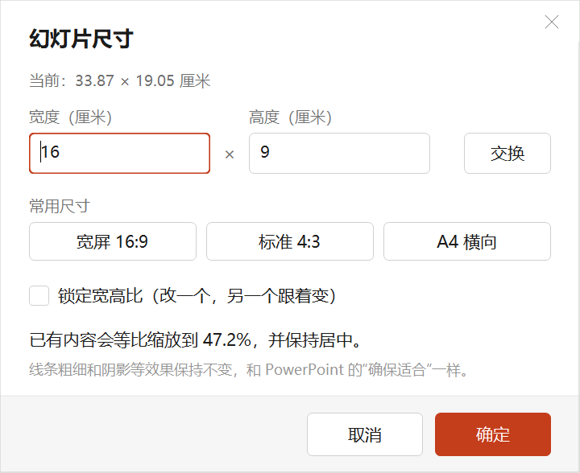
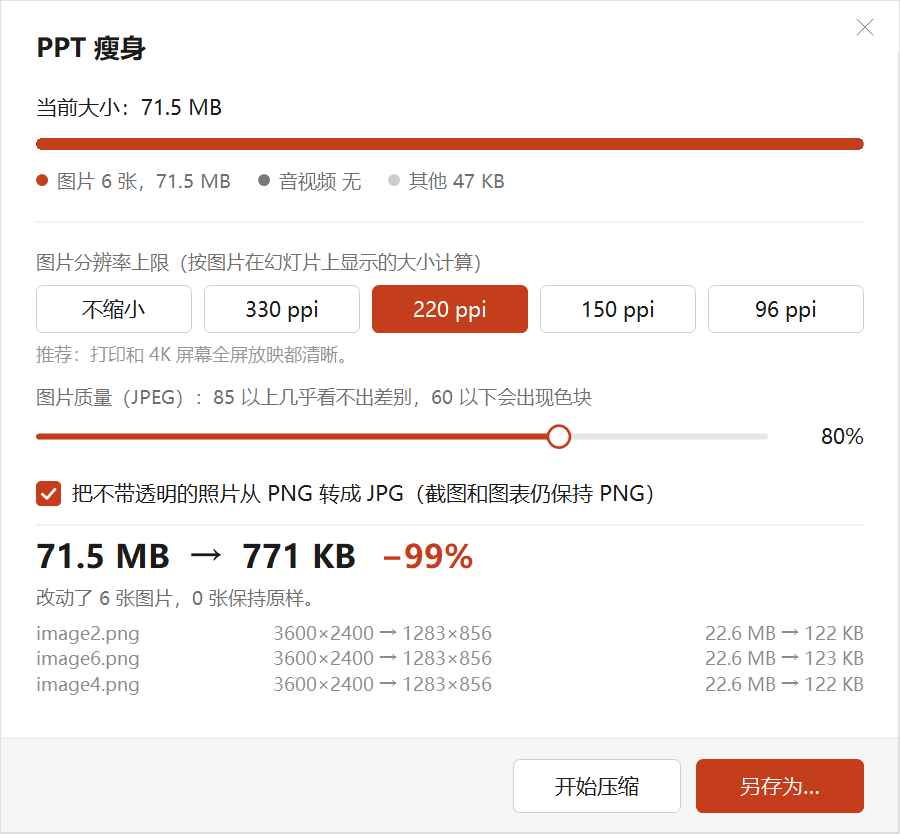

# Litchi PPT Tool

[English](README.md) | **简体中文**

**选区导出**（PowerPoint 插件）——给习惯用 PowerPoint 画图的人准备的小工具：在幻灯片上选中几个对象，点一下按钮，
就能把**只有这些对象**导出成 **PDF**、**SVG**、**PNG** 或 **JPG**，
范围是刚好包住它们的最小矩形，背景可以选透明或任意纯色。
另外还有一键**对齐和分布**（可以以某个对象为参照，连接线不会被拉断）、**旋转 / 翻转**、**层次**（置于顶层 / 底层、上移 / 下移一层）和**布尔运算**按钮，
直接改选中形状**填充颜色、轮廓颜色、粗细、虚线和线端类型**的“样式”分组，
按厘米**设置幻灯片尺寸**（已有内容自动等比缩放），
以及把图片压小、另存一份更小文件的 **PPT 瘦身**。



（中文版 Office 显示中文界面，其他语言的 Office 显示英文界面。）

## 为什么做这个

写论文、毕业设计或 LaTeX 文档时，要把幻灯片里的一张图单独拿出来，通常得导出整页再手动裁剪，
或者把幻灯片尺寸改成和图一样大。这个插件一步完成：

- **贴边裁剪。** 输出范围就是选中内容的外接矩形，和 PowerPoint 自带的“另存为图片”一致，
  线条粗细、箭头、阴影都算在内，边框不会被切掉一半。
- **只导出选中的对象。** 没选中的对象、幻灯片背景、母版上的图案都不会出现。
- **PDF 和 SVG 是矢量图。** 文字还是文字（PDF 内嵌字体），形状还是形状。
- **PNG / JPG 可选 96 – 600 DPI**，并把 DPI 写进文件，插入到别的软件里物理尺寸是对的。
- **背景透明或纯色**，所有格式都支持（JPG 不支持透明，选了透明时用白色）。
- **不动你的文档。** 不修改演示文稿，不影响撤销记录和剪贴板。

## 安装

要求：Windows，桌面版 PowerPoint（Microsoft 365 或 Office 2019 / 2021 / 2024，32 位、64 位均可）。
不需要管理员权限。

1. 打开 **[最新版 Release](https://github.com/Avopears/litchi-ppt-tool/releases/latest)**，在 *Assets* 里下载安装程序。
   文件名带版本号，例如 `Litchi-Setup-1.7.1.exe`。
2. 关闭 PowerPoint，运行安装程序。安装位置可以用默认的，也可以自己选文件夹。
3. 打开 PowerPoint，插件的选项卡叫 **Litchi**，就在“视图”后面。



安装程序没有代码签名，第一次运行时 Windows SmartScreen 可能提示“Windows 已保护你的电脑”，
点 **更多信息 → 仍要运行** 即可；不放心的话也可以自己从源码编译（见下文）。

**升级：** 直接运行新版安装程序，点 **升级** 即可。它会先把已安装的旧版本卸载干净（文件和注册信息），
再安装新版本；你保存的设置会保留。

卸载：Windows **设置 → 应用 → 安装的应用 → 选区导出 Export Selection for PowerPoint → 卸载**，
或者再运行一次安装程序，选“卸载”。

<details>
<summary>其他安装方式</summary>

- **不用 exe：** 把本仓库下载为 ZIP 并解压，关闭 PowerPoint 后双击 `安装.bat`（`卸载.bat` 用来卸载）。
- **静默安装：** `Litchi-Setup-<版本号>.exe /S` 安装（加 `/DIR="D:\Tools\Litchi"` 可指定位置），
  `Litchi-Setup-<版本号>.exe /uninstall /S` 卸载。

所有内容都只装给当前用户：插件复制到 `%LOCALAPPDATA%\Litchi Tool` 或你选的文件夹
（如果那个文件夹里已有别的东西，会在其中新建 `Litchi Tool` 文件夹），注册信息写在 `HKEY_CURRENT_USER` 下。
卸载时只删除插件自己的文件，不会动该位置里的其他东西。
</details>

## 使用

1. 在幻灯片上选中要导出的对象（Shift / Ctrl 点选，或拖框多选），也可以只选组合里的某几个子对象。
2. 在“背景”组里选 **透明背景** 或 **纯色**（点“纯色”下面的小箭头换颜色，有预设色和“其他颜色…”）。
   “其他颜色…”打开取色窗口：在外圈色环上拖动选色相，在色环中间的方块里拖动选深浅（左白右纯色，越往下越暗），
   或直接输入十六进制 / RGB 数值；
   下方有常用颜色和最近用过的颜色，双击色块直接确定。
3. 点 **导出 PDF**、**导出 SVG** 或 **导出图片**，选择保存位置。
   “导出图片”在保存对话框里选 PNG 或 JPG，清晰度由 **图片分辨率** 决定。



### 对齐

“对齐”组里的九个按钮（鼠标停在按钮上会显示名称和说明）：

| | 按钮 |
| --- | --- |
| 第一行 | 左对齐 · 左右居中 · 右对齐 |
| 第二行 | 上对齐 · 上下居中 · 下对齐 |
| 第三行 | 横向分布 · 纵向分布 · 对齐到对象（开关） |

- **对齐**：选中多个对象时，以它们的整体范围为准，和 PowerPoint 自带的对齐一样；只选一个对象时对齐到幻灯片。
- **分布**：最外侧的两个对象不动，中间的对象等距排开，至少要选 3 个。
- **对齐到对象**：打开后，**第一个选中的对象**作为参照，它本身不动。
  先单击参照对象，再按住 Shift 或 Ctrl 单击其他对象，然后点对齐按钮。
  这时分布会让其他对象在参照对象的范围内等距排开（两端也留出同样的间距），适合把几个对象均匀地放进一个框里。
  这个开关会被记住，下次打开 PowerPoint 时保持原样。
- **连接线跟着形状走**：选中的连接线如果连在形状上，不会被单独对齐，而是随它连着的形状移动，不会被拉断
  （PowerPoint 自带的对齐会把它们拉开）。
- 旋转过的对象按旋转后实际占据的范围对齐和分布。
- 每次对齐只占一步撤销，按一次 Ctrl+Z 就能整体撤回。

### 旋转

**向左旋转 90°**、**向右旋转 90°**、**水平翻转**、**垂直翻转**：每个选中的对象各自绕自己的中心转或翻，位置不变。

### 层次

对象互相重叠时用：上面一排是**置于顶层**、**上移一层**，下面一排是**置于底层**、**下移一层**，
就是 PowerPoint“排列”菜单里的那四个命令，放在手边一点就行。

- 同时选中多个对象时，它们之间的上下顺序不变，一起移动。
- 选中组合里的某个对象时，调整的是它在这个组合内部的层次。
- 每次点击都是一步撤销。

### 布尔

**联合**、**组合**（重叠部分镂空）、**剪除**、**拆分**，就是 PowerPoint 的“合并形状”。

- 先单击的形状是主形状：结果沿用它的填充和线条，“剪除”是从它身上剪掉其他形状盖住的部分。
- 至少选 2 个形状。组合不能直接运算，要先取消组合。
- 运算结果会被选中，按一次 Ctrl+Z 可以撤回。

### 样式

五个下拉列表，不用离开 Litchi 选项卡就能改选中形状的外观：

- **填充**：点色块，选中的形状立即换成这个填充色。色板下面有“无填充”和“其他颜色…”。
- **轮廓**：轮廓颜色；对线条和连接线来说就是线条本身的颜色。色板下面有“无轮廓”和“其他颜色…”。
- **粗细**：轮廓粗细，0.25 到 6 磅；“其他粗细…”可以输入 0.05 到 100 之间的任意数值。
- **虚线**：实线、圆点、方点、短划线、划线-点、长划线、长划线-点、长划线-点-点。
- **线端**：线条两端（以及虚线每一小段两端）的形状，方、圆、平三种，
  就是“设置形状格式 → 线条 → 线端类型”那一项。平：正好在端点处截止；方：两端各多出半个线宽；圆：两端是半圆。

色板和取色窗口里的常用颜色相同，后面跟着最近用过的颜色；“其他颜色…”打开取色窗口，可以直接输入十六进制或 RGB 色值。

- 选中组合时，组合里的每个形状都会改；也可以只选组合里的某几个形状。
- 线条没有填充，“填充”会跳过它们；表格、图表等对象也会被跳过。
- 给没有轮廓的形状选粗细或虚线时，会自动显示出轮廓（和 PowerPoint 一样）。
- 每次选择都是一步撤销。
- **线端**和其他几项不太一样：PowerPoint 没有给插件提供修改线端类型的接口，
  插件是先临时存一份演示文稿的副本、在副本里改好，再把格式套用回来。所以它只能用于普通幻灯片上的对象
  （母版、版式、备注页里的不行），文件特别大时要等一下；形状的其他格式和里面的文字都不会变。

### 幻灯片尺寸

“幻灯片”组里的 **设置尺寸** 按厘米设置幻灯片的宽度和高度。已经做好的内容会自动等比缩放并保持居中，
也就是 PowerPoint 改幻灯片大小时的“确保适合”：按宽、高两个比例里**较小**的那个缩放，原来在页面里的内容不会跑到页面外。



- 输入宽度和高度（厘米），或点常用尺寸（宽屏 16:9、标准 4:3、A4 横向）；“交换”对调宽高；
  勾上“锁定宽高比”后，改一个数另一个跟着变。窗口里会直接告诉你内容将缩放到百分之多少。
- 一起缩放的有：位置、大小、字号、文字边距、段落间距和缩进；表格、组合、连接线都跟着走。
- **线条粗细和阴影、发光等效果不缩放**，和 PowerPoint 自己的做法一致。
- 母版和版式随页面拉伸；没动过位置的占位符跟着版式走，手动挪过的占位符和普通形状一样缩放。
- 宽高都变大时，内容也按较小的那个比例放大。
- 每次设置是一步撤销，按一次 Ctrl+Z 就能撤回。
- PowerPoint 把页面尺寸存成 1/8 磅的整数倍，所以 16 厘米实际是 15.9985 厘米（显示出来仍是 16）。

### PPT 瘦身

“文件”组里的 **PPT 瘦身** 把演示文稿里的图片做小，另存成一份新文件。**原文件不会被改动。**



1. 窗口上方显示当前文件有多大，图片、音视频、其他内容各占多少。
2. 选**图片分辨率上限**和**图片质量**：
   - 分辨率按图片在幻灯片上显示的大小计算：220 ppi 打印和 4K 屏幕放映都清晰（默认），150 ppi 够投影仪和普通屏幕，
     96 ppi 最小、适合发邮件；也可以选“不缩小”，只重新压缩。
   - 质量是 JPEG 的压缩质量，默认 80%：85 以上几乎看不出差别，60 以下会出现色块。
3. 点**开始压缩**看前后大小。不满意就改设置再压一次，满意了点**另存为…**。
   默认存在原文件所在的文件夹，文件名是原名加 `_压缩`。

它是怎么处理每张图片的：

- 按图片在幻灯片上**实际显示的大小**来缩小。同一张图用在多处时按最大的那处算；裁剪过的图片，裁掉的部分按同样比例保留，
  以后还能重新调整裁剪；像素本来就不够的图片不会被放大。
- 不带透明的照片如果存成了 PNG，会转成 JPG（常常能小十倍）；截图、图表这类转了也小不了多少的保持 PNG；
  带透明的图片保持 PNG。不想转可以取消勾选。
- 只有变小了才替换。矢量图（EMF、SVG）、GIF 动图、音频和视频都不处理，只在窗口上方告诉你它们占了多少。
- 这是有损压缩，不可逆，所以只另存、不覆盖：不能把结果存回正在打开的那个文件。

## 需要知道的事

- PPT 瘦身里，带透明的 PNG 只能靠降低分辨率变小：Windows 自带的图片组件只能无损保存 PNG。

- 导出 PDF 需要在普通视图里选中幻灯片上的对象；母版、版式、备注页里的对象可以导出 SVG 或图片。
- 阴影、发光等效果在 PDF 里是位图，这是 PowerPoint 自身的行为。
- SVG 里的文字仍是文字，按字体名引用字体；别的电脑没有这个字体时会被替换。对外观要求严格时请用 PDF。
- 导出 PDF 时插件会先存一份演示文稿的临时副本，所以特别大的文件（几百 MB）要多等一会儿。
- 选中内容超过 56 英寸（PowerPoint 幻灯片的最大尺寸）时，PDF 会被裁到这个范围。

已在 Windows 11 上的 Microsoft 365（64 位、中文界面、版本 16.0.20625）测试过。
英文界面和其他 Office 版本按设计应当可用，但还没有实际测试，
欢迎[反馈问题](https://github.com/Avopears/litchi-ppt-tool/issues)。

## 从源码编译

不需要 Visual Studio，用 Windows 自带的 C# 编译器（.NET Framework 4）加上已安装的 Office 就够了：

```powershell
powershell -ExecutionPolicy Bypass -File .\build.ps1
```

会生成 `dist\PptSelectionExport.dll`（插件本体）和 `dist\Litchi-Setup-<版本号>.exe`（安装程序，DLL 已打包在里面）。

```powershell
powershell -ExecutionPolicy Bypass -File .\tests\run.ps1
```

会用本机的 PowerPoint 跑一遍测试：新建临时演示文稿，把各种选区按每种格式导出一遍，
再把各种对象对齐、分布一遍，并和 PowerPoint 自带命令的结果逐一比较，最后测旋转、翻转、层次、布尔运算、取色窗口的颜色换算、样式命令、线端类型、幻灯片尺寸（改成各种尺寸后逐个核对对象的位置、大小和字号）和 PPT 瘦身
（把一份塞满大图的演示文稿压小，检查每张图片的像素数，并逐页对比压缩前后的画面）。
末尾加 `align` 只跑导出以外的测试。

| 文件 | 作用 |
| --- | --- |
| `src/Connect.cs` | 加载项入口、选项卡按钮的响应 |
| `src/Ribbon.xml` | 选项卡界面定义 |
| `src/Exporter.cs` | SVG、PNG/JPG、PDF 三条导出流程 |
| `src/PdfCropper.cs` | 把 PowerPoint 生成的整页 PDF 精确裁到选区（PDF 增量更新） |
| `src/SvgTools.cs` | 读取选区范围、给 SVG 加背景 |
| `src/Aligner.cs` | 对齐和分布 |
| `src/ShapeTools.cs` | 旋转、翻转、层次和布尔运算 |
| `src/StyleTools.cs` | 填充颜色、轮廓颜色、粗细和虚线 |
| `src/LineCaps.cs` | 线端类型（通过演示文稿的临时副本设置） |
| `src/SlideResizer.cs`、`src/SlideSizeDialog.cs` | 幻灯片尺寸：改尺寸并把已有内容按一个比例缩放；尺寸窗口 |
| `src/Slimmer.cs`、`src/SlimDialog.cs` | PPT 瘦身：算出每张图片显示多大、缩小并重新编码、重写文件包；瘦身窗口 |
| `src/ColorPicker.cs`、`src/WeightDialog.cs` | 取色窗口、“其他粗细…”窗口 |
| `src/Strings.cs` | 全部界面文字（中文和英文） |
| `src/Icons.cs`、`src/Settings.cs` | 用代码画的图标、记住的设置 |
| `installer/Setup.cs` | exe 安装 / 卸载程序 |
| `tests/TestHarness.cs`、`tests/AlignTests.cs`、`tests/ShapeToolsTests.cs`、`tests/StyleTests.cs`、`tests/CapTests.cs`、`tests/ResizeTests.cs`、`tests/SlimTests.cs` | 直接驱动 PowerPoint 的测试 |

### 实现原理

- **SVG 和 PNG/JPG** 用的是 PowerPoint 自己的 `ShapeRange.Export`，它本身就按可见范围裁剪并保留透明。
  插件在此基础上加背景、`viewBox`、指定分辨率和 DPI 标记。
- **PDF**：PowerPoint 只能导出整张幻灯片。插件先存一份临时副本，把没选中的对象全部隐藏、去掉幻灯片背景，
  导出这一页，再往 PDF 末尾追加一段“增量更新”，把页面框改成选区范围。全程不栅格化，也不改写原有字节。
- **线端类型**：PowerPoint 的对象模型里没有这个属性，它只存在于文件里（`<a:ln cap="sq|rnd|flat">`）。
  插件存一份临时副本，在副本的幻灯片 XML 里写入线端类型，不带窗口地打开副本，
  再用 `PickUp` / `Apply`（格式刷）把副本里同一个形状的格式套用回来。副本里的形状先去掉了文字，
  否则 `Apply` 会把形状里所有文字都刷成第一段文字的格式。
- **幻灯片尺寸**：PowerPoint 的对象模型只能先改宽、再改高，而且每一步都自己缩放一次内容：
  页面变小时按这一步的比例缩，变大时不缩。于是宽高都变小会缩两次，都变大则完全不放大。
  插件先记下每个对象的位置、大小和每段文字的字号、边距、间距，让 PowerPoint 改尺寸（母版和版式由它适配），
  再把每个对象和每处文字精确改成“统一按一个比例缩放”的结果。从母版继承的文字格式只改母版，不在幻灯片上另写一份。
- **PPT 瘦身**：.pptx 是一个 zip 包，体积几乎都在 `ppt/media` 下的图片上。插件存一份临时副本，
  读每张幻灯片、版式、母版的 XML 和关系文件，算出每个图片文件在哪里用到、显示成多大（组合的缩放、裁剪、图片填充、背景都算在内），
  用 GDI+ 把它缩到“显示尺寸 × ppi”并重新编码，再把整个包按原来的顺序重写一遍。
  图片格式变了（PNG 变 JPG）就改文件名，同时更新指向它的关系和 `[Content_Types].xml`。其余内容原样复制。

## 许可证

[MIT](LICENSE)
